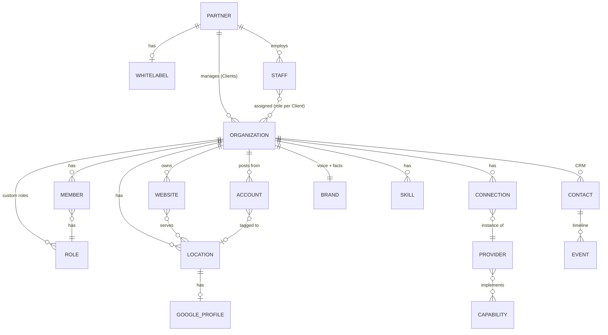

# Data model

The shared entities, as they exist in the mock today and what the real build plans for each. Feature-specific shapes live in each feature's `technical.md`. Terms follow [GLOSSARY.md](../GLOSSARY.md).

There is **no database yet**. Today every entity is a TypeScript type with seed data in `ui-mock/src/data/*`, plus a module store in `ui-mock/src/lib/*` that keeps changes in `localStorage` or in memory. The "Real build" column comes from the comments in those files.

## Hierarchy

A Connection attaches to the Partner, the Organization, a Location or a Website, so it isn't drawn under one parent.

## Entities

| Entity | Type in code | Seed / store today | Persisted today | Real build |
|---|---|---|---|---|
| Partner | `Partner` [data/partner.ts](../ui-mock/src/data/partner.ts) | one hardcoded Partner when `member.plan === "agency"` | no | partners table; one whitelabel row each |
| Organization | `Organization` [data/org.ts](../ui-mock/src/data/org.ts) | `organization`, `memberships` | no (added ones live until reload) | organizations table with `features` and `autopilot` JSON columns |
| Location | `Location` [data/mock.ts](../ui-mock/src/data/mock.ts) | `locations` + [lib/setup.ts](../ui-mock/src/lib/setup.ts) | no (in memory) | per Organization; keywords, grid, rankings stored per Location |
| Website | `Website` [data/org.ts](../ui-mock/src/data/org.ts) | `websites` + lib/setup.ts | no | per Organization; Search Console / GA4 / WordPress as Connections |
| Account | `Account` [data/social.ts](../ui-mock/src/data/social.ts) | `accounts` + lib/setup.ts | no | a Connection per Account |
| Member (Person) | `Person` [lib/access.ts](../ui-mock/src/lib/access.ts) | seed people | `gw-access` | Better Auth `member` + `invitation` rows per Organization |
| Partner staff | `Staff` lib/access.ts | seed staff | `gw-access` | Better Auth member rows on each Client, kept in step by hooks |
| Role | `RoleSpec` [data/access.ts](../ui-mock/src/data/access.ts) | 4 presets + custom | `gw-access` (custom) | Better Auth dynamic `organizationRole`, spec saved as an extra field |
| Feature switches | `Flags` [lib/features.ts](../ui-mock/src/lib/features.ts) | all on | `gw-features` | `organizations.features` JSON |
| Capability | `Capability` [data/integrations.ts](../ui-mock/src/data/integrations.ts) | static catalog | n/a | code, not data |
| Provider | `Provider` data/integrations.ts | static catalog | n/a | code, not data |
| Connection | `Connection` [lib/integrations.ts](../ui-mock/src/lib/integrations.ts) | read from feature stores + `gw-integrations` | partly | one `connections` table `{ id, provider, attach, targetId, account, credentialsRef, status, createdAt }`, credentials in a vault |
| Whitelabel | `Whitelabel` [lib/whitelabel.ts](../ui-mock/src/lib/whitelabel.ts) | defaults | `gw-whitelabel` | row per Partner, resolved from request host |
| Brand | [data/brand.ts](../ui-mock/src/data/brand.ts) | static | no | per Organization, drafted by Claude, edited by owner |
| Skill | `Skill` [data/skills.ts](../ui-mock/src/data/skills.ts) | built-in + public index | no (in memory) | SKILL.md files per Organization, public ones pinned to a version |
| Contact / Event | `Contact`, `Event` [data/contacts.ts](../ui-mock/src/data/contacts.ts) | seed contacts | `gw-crm` | `contacts`, `events`, `call_tasks` tables per Organization |
| Task | `Task` [lib/tasks.ts](../ui-mock/src/lib/tasks.ts) | built from mock actions | no (in memory) | tasks with a revert payload per applied change |
| Run | `Run` [lib/runs.ts](../ui-mock/src/lib/runs.ts) | seed runs | no (in memory) | `runs` table, progress from DataForSEO postbacks |
| Autopilot level | lib/autopilot.ts | per action defaults | `gw-autopilot` | `organizations.autopilot` JSON |
| Schedule | `Job` [lib/schedules.ts](../ui-mock/src/lib/schedules.ts) | per job defaults | `gw-schedules` | one cron row per Organization and job |

## Every localStorage key

The literal persistence layer of the mock. Clearing site data resets all of it.

| Key | Store | Holds |
|---|---|---|
| `gw-access` | lib/access.ts | people, custom roles, Partner staff, signed-in person |
| `gw-features` | lib/features.ts | feature on/off |
| `gw-integrations` | lib/integrations.ts | website tools, Slack, extra social accounts |
| `gw-whitelabel` | lib/whitelabel.ts | Partner brand |
| `gw-autopilot` | lib/autopilot.ts | Autopilot levels |
| `gw-schedules` | lib/schedules.ts | schedule frequencies |
| `gw-ads` | lib/ads.ts | ad connections, goal, recommendations, change log |
| `gw-creatives` | lib/creatives.ts | ad swipe file, briefs, batches, creatives |
| `gw-crm` | lib/crm.ts | contacts, timelines, call tasks, campaigns, workflows, sending setup |
| `gw-outreach` | lib/outreach.ts | sequencer connection, leads, threads, rules |
| `gw-saved-prospects` | lib/saved.ts | saved prospect searches and audits |
| `gw-audit-shares` | lib/shares.ts | share links and their views |
| `gw-marko-chats` | lib/assistant.ts | assistant chats |
| `gw-marko-pos` | components/Assistant.tsx | floating button position |
| `gw-theme` | lib/theme.ts | dark mode |

**In memory only** (reset on reload): Scope, setup (Locations, Websites, Google profiles, Accounts), tasks and their run state, runs, skills, social posts, swipe file, watched profiles, scanner state, articles.

## Known gaps in the model

- **One access store for every Organization.** `gw-access` holds one people list, so the same people appear on every Organization in the switcher. Real build is per Organization.
- **Organizations other than Maple & Main have no data.** Switching to another one, or adding one, shows Maple & Main's data.
- **Code still says `business`** where it means the Organization (`business` in data/mock.ts).
- **No user/session entity.** The signed-in person is `me: "p_anika"` in the access store; `member.plan` is a constant.
