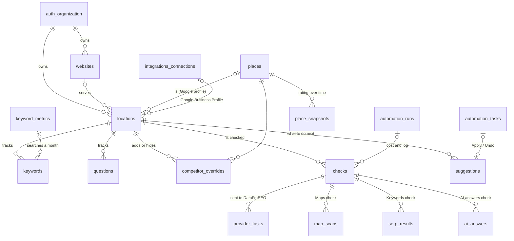
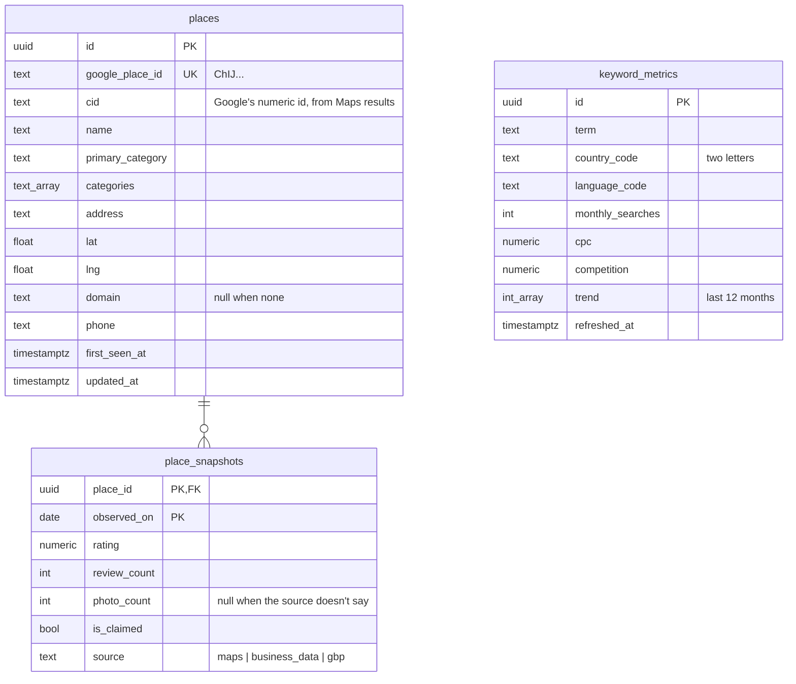
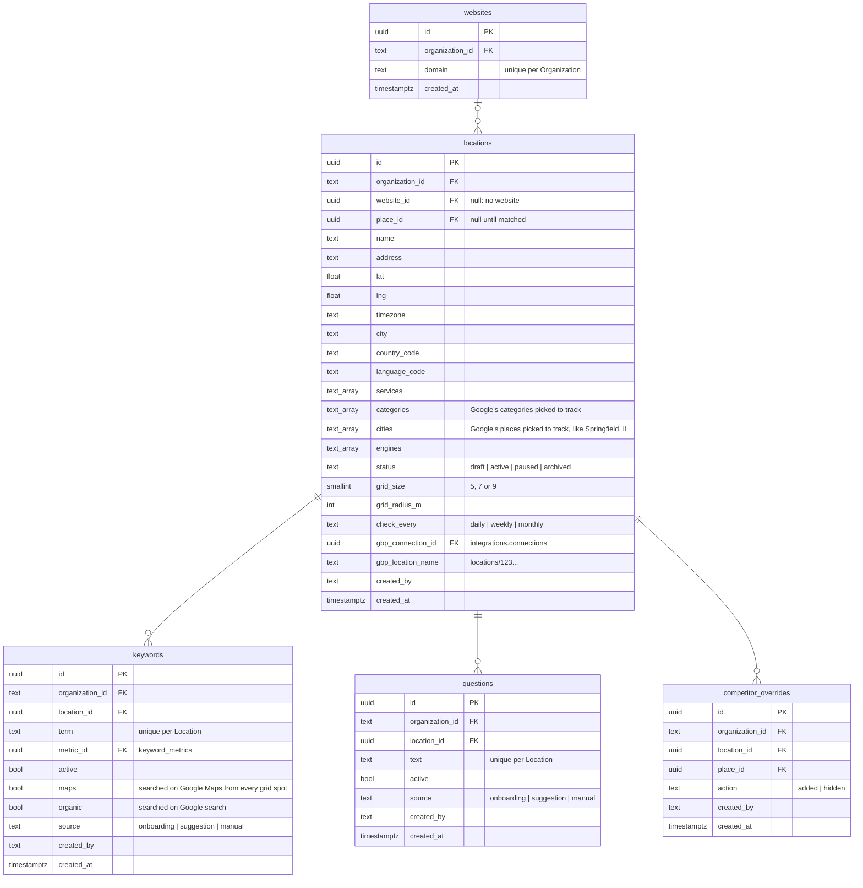
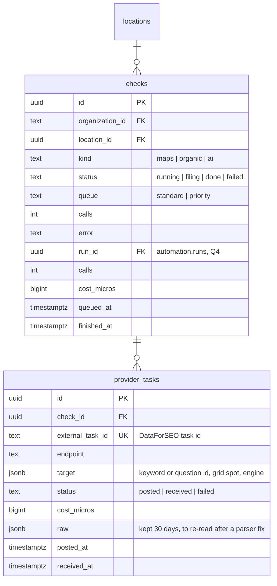
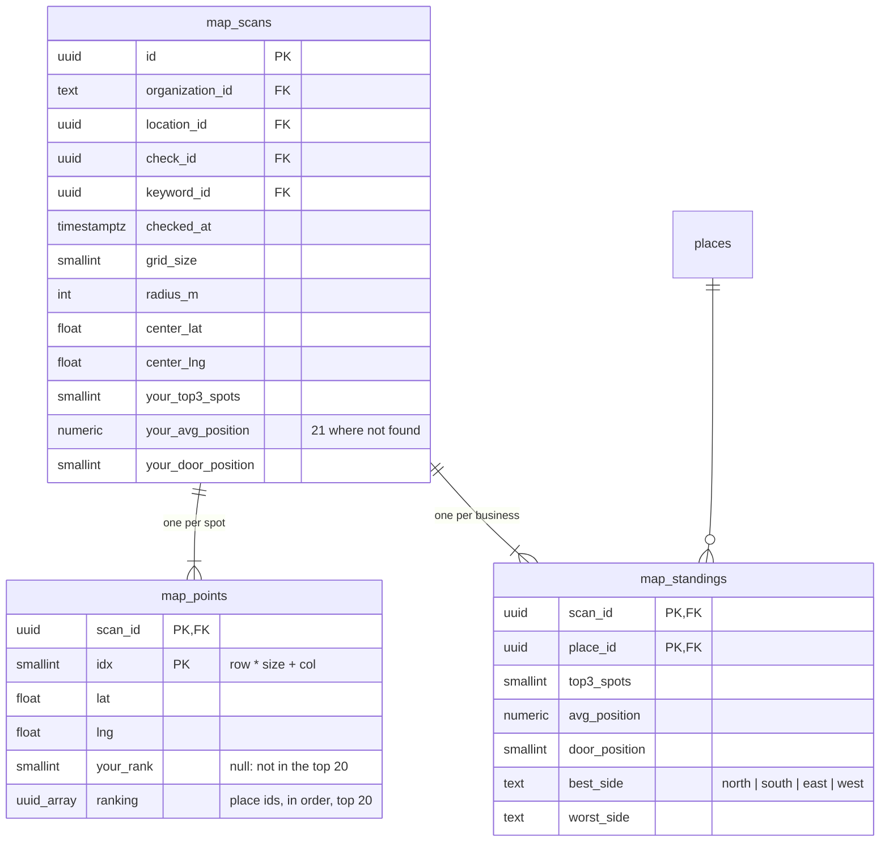
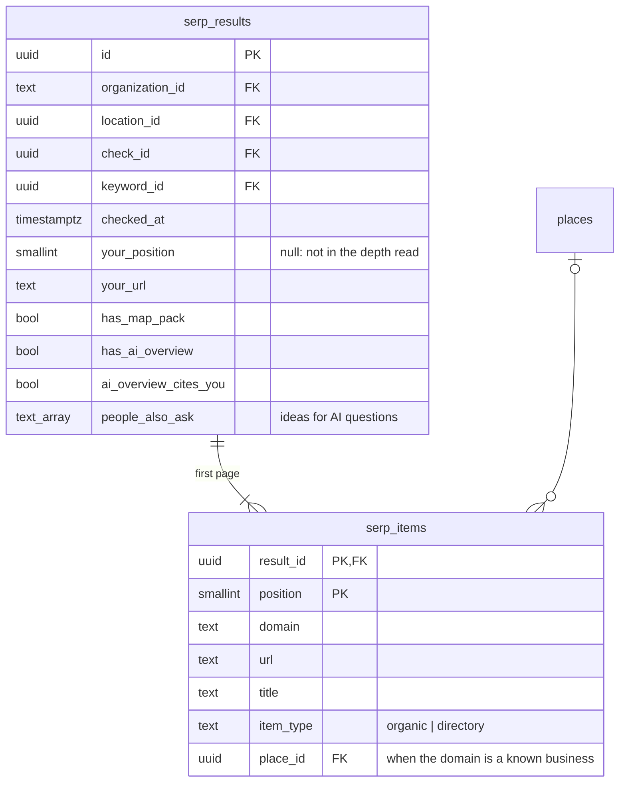
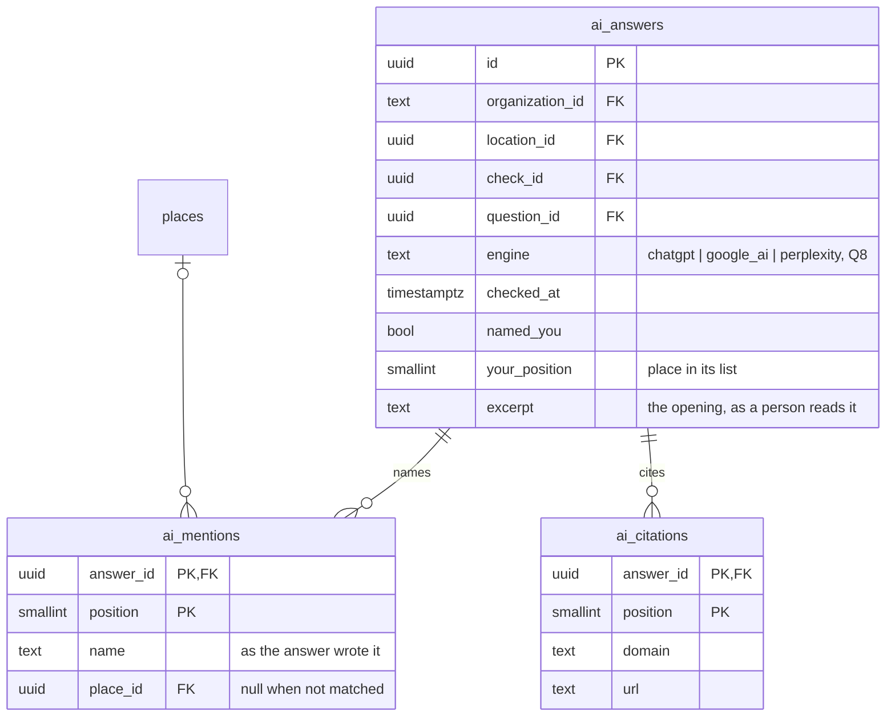
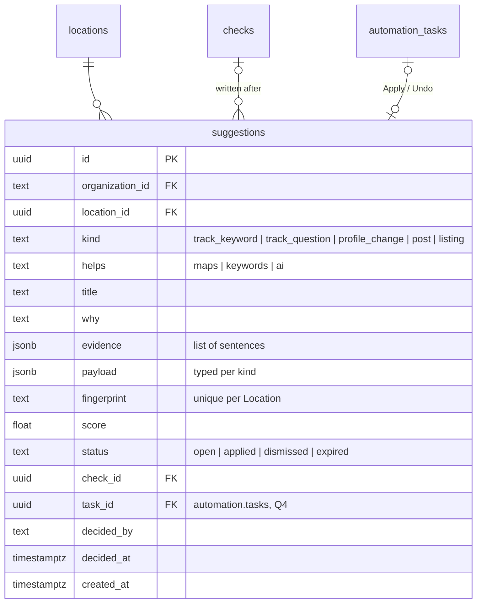
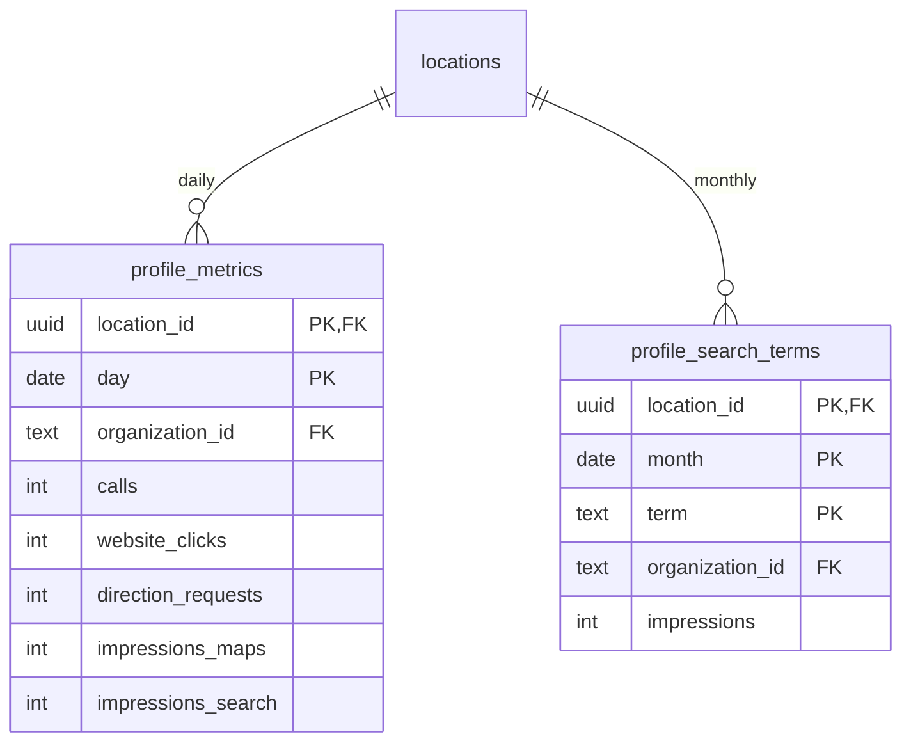

# SEO: data model

Status: **built** (`modules/seo/src/schema.ts`, migration `0004_seo`). Q1 to Q12 refer to the planning questions; every one
is decided below. ADR 0033 records the decisions.

What changed while building (2026-11-22):

- Locations are checked on **automation's schedule** (one `automation.schedules` row per Location, job `seo.check`), so there
  is no `next_check_at`. Each cycle of checks is one automation Run; its cost is the sum of its provider calls.
- `locations` also keeps `city`, `country_code`, `services` (keyword and question ideas come from them) and `engines` (the
  AI assistants its questions are asked of). `check_every` is `daily`, `weekly` or `monthly`.
- `keyword_metrics` is keyed by `country_code` (two letters) rather than a provider location code.
- `checks` also keeps `queue`, `calls` and `error`; its status is `running`, `filing` (claimed by the one collection that
  files it), `done` or `failed`. `provider_tasks.raw` holds the normalised result and `error` why a task failed.
- `suggestions.score` orders the list (higher first).
- A business is set up once per Organization: a partial unique index on `locations (organization_id, place_id)` for
  Locations that aren't archived (migration `0005`).
- "Checking" and a cycle's "finished" follow its automation Run, which finishes after the suggestions are written.

Decided (2026-11-21):

- Q1: an Organization has several Locations; the SEO pages show a Location switcher only when there's more than one.
- Q2: Websites are their own table.
- Q3: the public catalog is shared across Organizations.
- Q5: DataForSEO is the app's own account; customers pay through Plan limits, real spend is tracked per Organization.
- Q6: scheduled checks use the standard queue with postback (polling as fallback); the first check at Launch uses priority.
- Q7: v1 uses Google Business Profile and Places; Search Console and Analytics come later.
- Q8: engines are ChatGPT, Google AI Overviews and Perplexity.
- Q9: grid size and how often a Location is checked are limited by the Plan (`limit.seo_grid_size`, `limit.seo_checks_per_month`).
- Q10: API costs becomes an App admin page with real spend per Organization.
- Q11: onboarding starts after creating an Organization when SEO is on, and from the SEO page with no Location; customers see Plan usage, not dollars.

- Q4: applying a suggestion goes through an automation Task executor (Apply, Undo, Activity, Autopilot); the `seo`
  module depends on `automation`.
- Q12: v1 includes competitor facts from Maps results, the results card (Business Profile performance), and three
  more suggestion kinds: get listed, question ideas from "People also ask", and profile gaps. Review replies are not
  in v1, so there is no `reviews` table yet.
- Google Business Profile API access is not approved yet; the Google adapter is built and tested in stub mode until
  it is.

All tables live in the Postgres schema `seo`. Ids are UUIDv7 made in the app. Timestamps are `timestamptz`.

## The three layers

1. **Public catalog.** Facts about the outside world that are the same for everyone: Google businesses, their
   ratings over time, monthly searches for a term. No `organization_id`. A row says nothing about who tracks it (Q3).
2. **What an Organization tracks.** Its Locations, Websites, keywords, questions, competitor exceptions and
   suggestions. Every row has `organization_id` and cascades when the Organization is deleted.
3. **Results.** What each check found, over time. Summaries are worked out once, when results arrive, so pages
   read small tables and never add up raw data on request.

Rule for `organization_id`: a table that routes query directly carries it (for scoping and cascade). A pure child
row (a grid spot, a SERP item, an AI mention) cascades from its parent and does not repeat it.

## Overview

Outside the `seo` schema: `auth.organization` (Better Auth), `integrations.connections` (the Google Connection),
`automation.runs` and `automation.tasks` (Q4). Usage and cost per DataForSEO call are recorded by
`integrations.invoke()` as for any metered provider.

## 1. Public catalog

- `places` gets one row per business seen in any result, upserted by `google_place_id`. Competitors are rows here,
  not a list somebody types.
- `place_snapshots` keeps at most one row per place per day. Maps results already carry rating, review count,
  categories and claimed, so most snapshots cost nothing. New reviews a month is the change between two snapshots.
- `keyword_metrics` is unique on `(term, country_code, language_code)` and refreshed monthly, once, however many
  Organizations track the term.

## 2. What an Organization tracks

- A Location is the business being tracked (Q1: several per Organization). Its status is `draft` through
  onboarding and becomes `active` at Launch.
- A Website can serve several Locations (Q2). Google search positions are read for the Website's domain.
- Competitors found in results are never stored as tracked rows. `competitor_overrides` holds only the exceptions:
  added by hand (shown as **Added by you** until the next check) or hidden.
- Plan limits count rows here: `limit.seo_locations`, `limit.seo_keywords` (active keywords per Location),
  `limit.seo_questions`.

## 3. Checks and the calls behind them

- One `checks` row per Location per kind per cycle. "Checked Monday" on the overview is the latest finished check.
- `provider_tasks` exists because DataForSEO's standard queue is asynchronous (Q6): we post tasks, DataForSEO
  calls back (postback) or we poll, and this table matches each result to its keyword, spot or question. A check is
  done when all its tasks are received; then the summaries below are written in one transaction.

## 4. Results

### Maps check

- `map_points.ranking` keeps the whole order at a spot in one row: 49 rows per scan rather than about 980. Anyone's
  map (yours or a competitor's) is rebuilt from it, and tapping a spot shows its top 3.
- `map_standings` is the summary the pages read: who holds how many spots, who leads, **Compare profiles**, and the
  90-day chart (one row per business per weekly scan). Your own Location's place has a row too.

### Keywords check (Google search)

### AI answers check

- Answers name businesses as free text; `place_id` is filled when the name matches a place nearby. Unmatched
  names still count in **Competitors** under the AI answers channel.
- `ai_citations` feeds the "Get listed on Healthgrades" kind of suggestion (Q12).

### Competitors check

No table of its own. It reads `map_standings`, `serp_items` and `ai_mentions` for the Location's latest checks,
minus `competitor_overrides` hidden, plus those added, and the newest `place_snapshots` for profile facts.

## 5. Suggestions

- `payload` is a union checked by a zod schema per `kind`: a term to track; a profile field before and after; a
  post's text; a directory to get listed on.
- `fingerprint` (kind plus its subject, such as `track_keyword:emergency dentist austin`) stops a dismissed or
  applied suggestion coming back each week.
- Apply and Undo go through an automation Task executor, which keeps the revert data, writes Activity and lets
  Autopilot act (Q4). `listing` and profile gaps (a `profile_change` with an empty before) come from the
  improvements (Q12); question ideas from "People also ask" are `track_question` suggestions.

## 6. With Google Business Profile connected (Q12)

From the Business Profile APIs, only for a connected Location. `profile_metrics` is the **results** card on the
overview (are rankings turning into calls?); `profile_search_terms` are real searches that showed the profile and
seed keyword suggestions. Reviews (and replying to them) are not in v1.

## Volume and growth

One Location with 20 keywords, a 7 × 7 grid, 5 questions on 3 engines, checked weekly, writes about 8,000 rows a
month (4,200 `map_points`, 2,000 `map_standings`, 860 `serp_items`, 65 `ai_answers` and their children). A thousand
Locations is about 8 million rows a month.

- Every results table is indexed on `(location_id, checked_at)` or reached through its parent's primary key.
- Summaries (`map_scans`, `map_standings`, `serp_results`, `ai_answers`) are kept indefinitely; spot-level rows
  (`map_points`) and `provider_tasks.raw` can be pruned on a schedule (13 months and 30 days).
- If tables grow past what indexes handle, the results tables split by month on `checked_at` (children would then
  carry `checked_at` too). No query changes.
