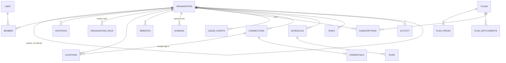

# Baseline schema

Status: **reviewed 2026-10-31**, changes applied. Nothing below exists in the database yet. Terms follow [GLOSSARY.md](../../../GLOSSARY.md).

This is the baseline every module builds on: identity, Organizations and Partners, access, feature switches, settings, billing, integrations and automation. The SEO module's tables come in a later piece, in `seo` ([roadmap](roadmap.md)).

## Conventions

| Rule | Why |
|---|---|
| One Postgres schema per module: `auth`, `core`, `billing`, `integrations`, `automation` (later `seo`, `social`…). pg-boss owns `pgboss`. | Ownership is visible; a module can be dropped or split out ([ADR 0008](../../decisions/0008-modules-by-feature.md)). |
| IDs are `uuid`, version 7, made in the app (`Bun.randomUUIDv7()`). | Time-ordered, so inserts stay at the end of the index; no ID-guessing. |
| **Every tenant row has `organization_id`**, and every index on a tenant table starts with it. Join tables carry it too. | One filter isolates a tenant; row-level security can be added later without changing tables. |
| Timestamps are `timestamptz`. Every table has `created_at`; mutable ones `updated_at`. | |
| Every tenant table has a foreign key `organization_id → auth.organization ON DELETE CASCADE`. | Hard-deleting an Organization removes everything in one statement (§ Archive and delete). |
| Organizations, Locations and Websites can be **archived** (`archived_at`): hidden and inactive, nothing removed, reversible. | History and rankings stay readable. |
| Money is integer cents; provider cost is integer **micros** (millionths of a dollar). | A DataForSEO map task costs $0.0006 = 600 micros. |
| Status fields are `text`, with allowed values checked in code (TypeBox), not Postgres enums. | Adding a value needs no migration. |
| `jsonb` only for configuration and opaque provider payloads, never for anything we filter, join or sum. | Queryable data stays in columns. |
| High-volume, append-only tables are **partitioned by month** on their time column. Their primary key includes that column. | Old months can be dropped or archived cheaply; scans stay fast. |
| Our tables: plural `snake_case`. Better Auth's tables keep its singular names. | Better Auth upgrades and docs stay simple. |

## Overview



Settings and the outbox are keyed by scope and aren't drawn.

---

## `auth`: identity, Organizations, Members, Roles

Owned by the `identity` and `access` modules. Created by Better Auth; extra fields are marked **+**.

```sql
auth.user
  id              uuid pk
  name            text
  email           text unique
  email_verified  boolean
  image           text
  created_at, updated_at

auth.session
  id                      uuid pk
  user_id                 uuid → user
  token                   text unique
  expires_at              timestamptz
  ip_address, user_agent  text
  active_organization_id  uuid → organization   -- the switcher
  impersonated_by         uuid null             -- support "sign in as"
  created_at, updated_at

auth.account          -- Better Auth's sign-in methods (password, Google login).
                      -- Not the Glossary's "Account" (a social profile), which lives in a later module.
  id, user_id, provider_id, account_id, password (hash), access_token, refresh_token, …, created_at, updated_at

auth.verification     -- email codes, password reset
  id, identifier, value, expires_at, created_at

auth.organization
  id          uuid pk
  name        text
  slug        text unique
  logo        text
+ partner_id  uuid null → organization   -- set on a Client: its Partner (ADR 0011)
+ category    text            -- "Dentist"; drives defaults and skills
+ timezone    text            -- IANA, e.g. America/Chicago; schedules run in it
+ features    jsonb           -- feature switches: { "rankings": false }. Missing key = on. (ADR 0006)
+ archived_at timestamptz null
  metadata    text
  created_at
  index (partner_id) where partner_id is not null

auth.member
  id               uuid pk
  organization_id  uuid → organization
  user_id          uuid → user
  role             text           -- preset id or custom role name
  created_at
  unique (organization_id, user_id)

auth.invitation
  id, organization_id, email, role, status ('pending'|'accepted'|'rejected'|'canceled'), expires_at, inviter_id, created_at
  index (organization_id, status)

auth.organization_role     -- custom Roles (Better Auth dynamic access control)
  id               uuid pk
  organization_id  uuid → organization
  role             text            -- name
  permission       text            -- compiled { resource: actions[] } (ADR 0003)
+ spec             jsonb           -- the RoleSpec the editor reopens; recompiled when features are added
  created_at, updated_at
  unique (organization_id, role)
```

Preset Roles (Owner, Admin, Editor, Viewer) are code, compiled from `data/access.ts`, not rows.

**Signing in with Google is not connecting a Google Business Profile.** A Member's Google login is an `auth.account` row (Better Auth) and grants nothing beyond sign-in. Managing a Google Business Profile needs its own Connection (`integrations.connections`, provider `google_business_profile`), authorised by whichever Google account manages that profile. That account can belong to someone else, such as the owner or the previous agency, and is never assumed to be the signed-in Member's.

**Access is one rule: a `member` row.** `user` is one flat table. A person can open an Organization if and only if they have a member row on it, with one Role. That holds for the business's own people and for agency staff alike; there is no staff table and no copied rows.

**Partners are Organizations.** A Client has `partner_id` pointing at its Partner's Organization. What makes an Organization a Partner is its Plan's `partner` Entitlement, not a column. Agency staff are members of the Partner's Organization (for Partner settings, whitelabel, billing) and get a member row on each Client they work on. A Partner Admin can add themselves or colleagues to any of the Partner's Clients. Clients can't have Clients (one level, checked by the organizations service). Transfer out: see [ADR 0011](../../decisions/0011-partner-is-an-organization-row.md); the Owner picks, person by person, which agency members lose access.

---

## `core`: Locations, Websites, settings, domains, events, activity

Owned by the `organizations` and `settings` modules and the kernel. Feature switches are the `features` column on `auth.organization`, so they arrive with the Organization on every request.

```sql
core.locations
  id               uuid pk
  organization_id  uuid → auth.organization
  name             text
  address_line1, address_line2, city, region, postal_code text
  country          text           -- ISO 3166-1 alpha-2
  lat, lng         double precision
  phone            text           -- E.164
  timezone         text null      -- falls back to the Organization's
  -- Google Business Profile: a Location has at most one, and a profile belongs to one Location.
  gbp_id            text null      -- "locations/1234567890"; null only while the profile is pending connection.
                                   -- A Location without one does nothing: its pages show Connect, its jobs don't run.
  gbp_connection_id uuid null → integrations.connections   -- the Google account that manages the Business Profile
  place_id          text null      -- Google place id, for public data (rankings, competitors)
  website_url       text null      -- the link on the Google Business Profile (may be a deep link). Shown, never audited.
  created_at, updated_at, archived_at
  index (organization_id) where archived_at is null
  unique (gbp_id) where gbp_id is not null

core.websites
  id               uuid pk
  organization_id  uuid → auth.organization
  domain           text           -- lowercase host, no scheme: "mapleandmain.com"
  created_at, updated_at, archived_at
  unique (organization_id, domain)
  -- Independent of Locations. Audits, Search Console and GA4 work per domain, with no Location needed.

core.settings                   -- every other per-scope setting, one jsonb blob per namespace
  scope_type   text             -- 'user' | 'organization' | 'partner' | 'location' | 'website'
  scope_id     uuid
  namespace    text             -- 'autopilot', 'notifications', 'appearance', 'whitelabel', 'seo.grid'…
  value        jsonb            -- validated by the owning module's schema
  version      int              -- optimistic locking: update … where version = $n
  updated_by   uuid, updated_at
  primary key (scope_type, scope_id, namespace)

core.domains                    -- whitelabel hosts, looked up on every request (ADR 0004)
  host         text pk          -- "app.brightlinelocal.com" or "brightline.openmarko.com"
  partner_id   uuid → auth.organization   -- the Partner whose brand this host shows
  status       text             -- 'pending' | 'verified' | 'failed'
  verified_at  timestamptz null
  created_at

core.outbox                     -- events between modules (ADR 0009)
  id               uuid pk      -- v7, so ordered
  event            text         -- 'review.received', 'location.created'…
  organization_id  uuid null
  payload          jsonb
  available_at     timestamptz  -- for retries with backoff
  attempts         int
  last_error       text null
  processed_at     timestamptz null
  created_at
  index (available_at) where processed_at is null

core.activity                   -- Activity: who changed what. Partitioned by month on created_at.
  id               uuid
  organization_id  uuid
  actor_type       text         -- 'member' | 'assistant' | 'system' | 'partner_staff'
  actor_id         uuid null
  action           text         -- 'reviews.post', 'setup.connect'… (the Action id)
  resource_type    text         -- 'review', 'location', 'connection'…
  resource_id      uuid null
  location_id      uuid null    -- for Scope filtering
  summary          text         -- one human line
  data             jsonb null   -- before/after where useful
  task_id, run_id  uuid null
  created_at       timestamptz
  primary key (id, created_at)
  index (organization_id, created_at desc)
```

Whitelabel brand (name, assistant name, logo, icon, accent, email sender) is `core.settings` with `scope_type = 'partner'`, `namespace = 'whitelabel'`. Only the host lookup needs its own table.

---

## `billing`: Plans, Entitlements, subscriptions, usage

Owned by the `billing` module ([ADR 0012](../../decisions/0012-billing-module-and-plans-as-data.md)).

```sql
billing.plans
  id          text pk          -- any id you choose: 'starter', 'growth', 'agency_10'
  name        text
  active      boolean          -- can new customers pick it
  sort        int
  created_at, updated_at

billing.plan_prices
  id                 uuid pk
  plan_id            text → plans
  interval           text     -- 'month' | 'year'
  amount_cents       int
  currency           text     -- 'usd'
  provider_price_id  text null  -- Stripe price id; null for manual-only plans
  active             boolean
  unique (plan_id, interval, currency) where active

billing.plan_entitlements
  plan_id  text → plans
  key      text               -- see "Entitlement keys" below
  value    bigint null        -- on/off: 1/0. limit: the number. NULL = unlimited.
  primary key (plan_id, key)

billing.subscriptions
  id                        uuid pk
  organization_id           uuid → auth.organization   -- who pays: an Organization or a Partner
  plan_id                   text → plans
  price_id                  uuid → plan_prices
  status                    text   -- 'trialing' | 'active' | 'past_due' | 'canceled' | 'incomplete'
  provider                  text   -- 'stripe' | 'manual' (assigned by an admin, no payment)
  provider_customer_id      text null
  provider_subscription_id  text null unique
  quantity                  int    -- seats or Clients, if the price is per unit
  trial_ends_at, current_period_start, current_period_end, cancel_at, canceled_at  timestamptz null
  created_at, updated_at
  unique (organization_id) where status in ('trialing','active','past_due')   -- one live subscription each

billing.entitlement_overrides     -- comps, extended trials, support changes
  organization_id  uuid
  key              text
  value            bigint null
  reason           text
  expires_at       timestamptz null
  created_by       uuid, created_at
  primary key (organization_id, key)

billing.plan_meters               -- how each metered use is sold, per Plan (any number of meters; the owner decides the packages)
  plan_id          text → plans
  meter            text           -- 'llm.tokens', 'dataforseo.maps', 'grid.points'…
  included         bigint null    -- units included per period; NULL = unlimited
  overage          text           -- 'block' | 'charge' | 'byok_only' (only allowed with the Organization's own key)
  unit_price_micros bigint null   -- price per unit beyond `included`, when overage = 'charge'
  primary key (plan_id, meter)

billing.usage_events              -- one row per metered call to a paid provider (ADR 0012 metering rule). Free integrations write none. Partitioned by month on occurred_at.
  id               uuid
  organization_id  uuid
  meter            text           -- 'dataforseo.maps', 'dataforseo.llm', 'grid.points'…
  quantity         bigint         -- units of the meter
  cost_micros      bigint         -- what it cost us
  provider         text
  mode             text           -- 'live' | 'stub' (ADR 0013)
  run_id           uuid null
  occurred_at      timestamptz
  primary key (id, occurred_at)
  index (organization_id, meter, occurred_at)
```

**Entitlement keys.** Plans are pure data; no code knows about "agency" or "local". Every check reads a key:

| Key | Value | Checked by |
|---|---|---|
| `feature.<FeatureId>` | 1/0. Missing = 0 | Feature check: off by Plan means the Organization can't turn it on |
| `action.<resource>.<action>` | 0 removes that Action for everyone on the Plan, whatever their Role. Missing = allowed | Permission check: role permission ∩ Plan |
| `limit.<name>` | a number, NULL = unlimited. Missing = unlimited | The service that adds the thing (`limit.locations`, `limit.keywords`, `limit.grid_points`, `limit.clients`, `limit.members`…) |
| `partner` | 1 = may have Clients and use whitelabel | organizations module |

New keys need code only where they're checked; new Plans need none. A limit is counted on the Organization it's checked against (a Partner's `limit.clients` counts its Clients; a Client's `limit.locations` counts its own).

**Resolving an Organization's Entitlements:** its own live subscription's Plan → else its Partner's → then overrides on top. The result is cached per request. Limits stop adding more; they never hide what exists.

---

## `integrations`: Connections and credentials

Owned by the `integrations` module ([ADR 0002](../../decisions/0002-capabilities-not-providers.md), [0010](../../decisions/0010-envelope-encrypted-credentials.md)). Capabilities and Providers are code, imported from `data/integrations.ts`.

```sql
integrations.connections
  id                uuid pk
  organization_id   uuid null → auth.organization   -- the owner. Null only for platform-owned Connections (the default LLM, ADR 0014)
  provider_id       text          -- 'google_business_profile', 'search_console', 'stripe'…
  target_type       text          -- 'platform' | 'partner' | 'organization' | 'location' | 'website'
  target_id         uuid
  external_id       text          -- the provider's id for it: GBP location name, GSC property
  label             text          -- what the UI shows: "Maple & Main — South Congress"
  status            text          -- 'ok' | 'action' | 'pending' | 'revoked'
  status_note       text null     -- "Reconnect: Google access expired"
  capabilities      text[]        -- capabilities this connection serves (a subset of the provider's)
  mode              text          -- 'live' | 'stub'
  created_by        uuid, created_at, updated_at, revoked_at
  index (organization_id, target_type, target_id) where revoked_at is null
  unique (provider_id, external_id, target_id) where revoked_at is null

integrations.credentials
  connection_id  uuid pk → connections
  organization_id uuid
  ciphertext     bytea          -- the secret JSON, AES-256-GCM with its data key
  nonce          bytea
  wrapped_key    bytea          -- the data key, encrypted with the master key
  key_version    int            -- which master key
  expires_at     timestamptz null   -- access token expiry, for refresh jobs
  created_at, rotated_at

-- LLM access (ADR 0014): a Connection with capability llm.complete. An Organization's own key is
-- an Organization-owned Connection; with none, the platform-owned Connection (target_type 'platform') is used.
-- Model per job lives in core.settings, namespace 'llm.routes', scope 'platform' or 'organization'.

integrations.webhook_events      -- raw inbound webhooks, for idempotency and replay
  id            uuid pk
  provider_id   text
  external_id   text           -- the provider's event id
  received_at   timestamptz
  payload       jsonb
  processed_at  timestamptz null
  error         text null
  unique (provider_id, external_id)
```

"Max one per Location" for a capability is enforced by the integrations service (the rule is per capability, not per row). The new Connection replaces the old one in the same transaction.

---

## `automation`: Schedules, Runs, Tasks

Owned by the `automation` module ([ADR 0005](../../decisions/0005-one-task-store.md)). Autopilot levels are `core.settings` (`namespace = 'autopilot'`).

```sql
automation.schedules
  id               uuid pk
  organization_id  uuid
  job_id           text           -- 'profile', 'rank', 'ai', 'audit'… (JobId in lib/schedules.ts)
  target_type      text null      -- 'location' | 'website'; null = whole Organization
  target_id        uuid null
  every            text           -- 'hourly' | '6h' | 'daily' | '3d' | 'weekly' | 'monthly'
  at               text null      -- '06:00', 'mon'
  paused           boolean
  next_run_at      timestamptz
  last_run_at      timestamptz null
  created_at, updated_at
  unique (organization_id, job_id, target_id)
  index (next_run_at) where not paused

automation.runs                  -- Activity → Runs
  id               uuid pk
  organization_id  uuid
  kind             text           -- RunKind: 'rank', 'profile', 'audit'…
  label            text
  trigger          text           -- 'scheduled' | 'manual' | 'event'
  status           text           -- 'queued' | 'running' | 'done' | 'failed' | 'canceled'
  progress         real           -- 0–1
  expected_sec     int null
  target_type      text null, target_id uuid null
  schedule_id      uuid null → schedules
  created_by       uuid null
  cost_micros      bigint         -- sum of its usage_events
  error            text null
  queued_at, started_at, finished_at  timestamptz
  index (organization_id, queued_at desc)
  index (status) where status in ('queued','running')

automation.tasks                 -- To-do, the assistant's task rows, review replies
  id               uuid pk
  organization_id  uuid
  kind             text           -- 'profile_edit', 'review_reply', 'site_fix'…
  feature_id       text           -- for switches and permission checks
  action           text           -- the Action it needs: 'reviews.post'
  status           text           -- 'open' | 'applying' | 'applied' | 'dismissed' | 'failed' | 'reverted'
  title, why       text
  impact           text null      -- 'high' | 'medium' | 'low'
  target_type      text null, target_id uuid null
  source_type      text null, source_id uuid null    -- what raised it: a review, an audit issue
  preview          jsonb null     -- { label, before, after } for the UI
  payload          jsonb          -- what the executor applies
  revert           jsonb null     -- written by the executor; Undo applies it
  autopilot        boolean        -- applied on its own (vs. by a Member)
  created_by_type  text, created_by uuid null
  applied_by uuid null, applied_at timestamptz null
  created_at, updated_at
  index (organization_id, status, created_at desc)
  unique (organization_id, kind, source_id) where status = 'open'    -- no duplicate open tasks
```

---

## Archive and delete

- **Archive** (Owner or Admin): `auth.organization.archived_at` is set. Members can't open it, schedules stop, nothing is removed. Unarchive clears it.
- **Hard delete** (Owner only, immediate): emits `organization.deleting` and waits for handlers (billing cancels the subscription, integrations revoke provider tokens), then deletes the row. `ON DELETE CASCADE` removes every tenant row in every module's schema.

## How this scales

- **Tenant isolation:** every query and index leads with `organization_id`. If one Organization becomes huge, or we need data residency, this is also the shard key.
- **Growth is in a few tables:** `activity`, `usage_events` and, later, SEO's rank snapshots, grid points and AI answers. They're partitioned by month from day one.
- **Hot lookups are single-index:** host → Partner (`domains.host`), due schedules (`next_run_at`), unprocessed events (`outbox` partial index), live subscription (partial unique).
- **No cross-module joins**, so any schema can move to its own database later.

## Open questions for review

None open. Settled 2026-10-31: Partner as an Organization with Clients pointing at it, access only through member rows; Websites independent of Locations; Google Business Profile ID on the Location; Plans define every limit and permission (no account-type rules); feature switches as a jsonb column; archive plus immediate hard delete.
