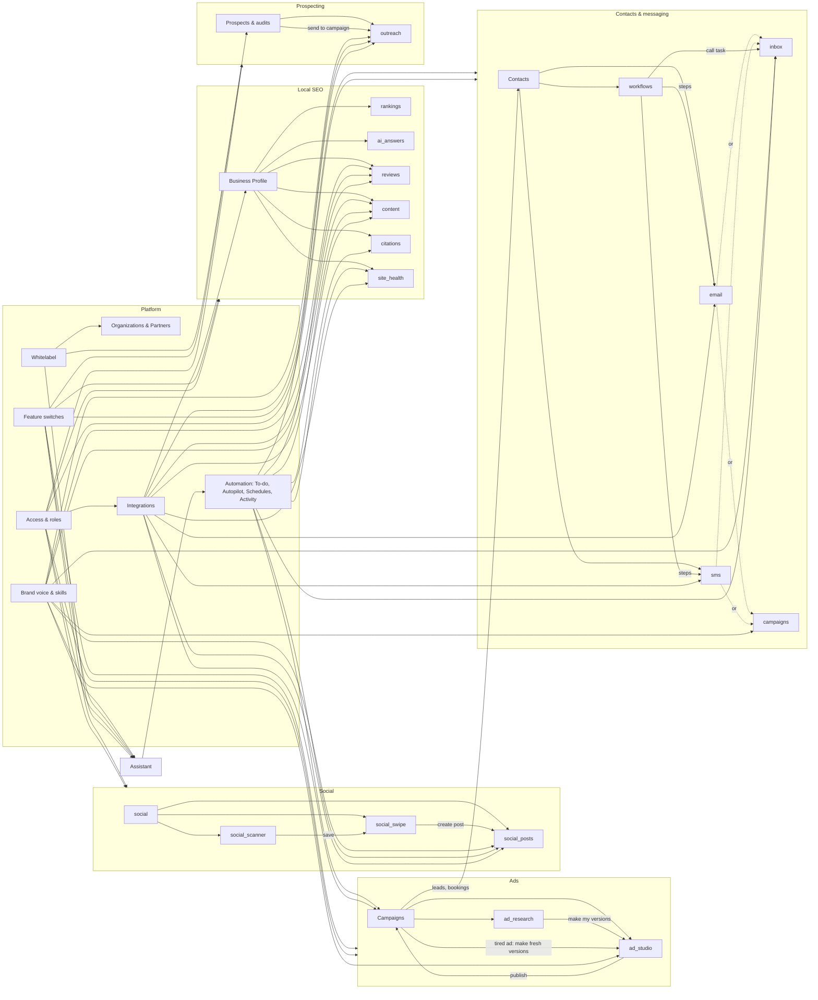

# Product map

What OpenMarko is made of and how the pieces depend on each other. Last checked against `105911e`.

OpenMarko is where a local business does its marketing: search (local, AI and general), reviews, social, ads, and messages with customers. Agencies (Partners) run it for many businesses under their own brand.

**Everything below is `mock`**: clickable in [ui-mock/](../ui-mock/) with no backend. See [README.md § Status](README.md#status).

## Modules and features

Source of truth: [ui-mock/src/data/features.ts](../ui-mock/src/data/features.ts). A feature works only when it's on, its module is on, and (for `needsAny`) at least one thing it needs is on.

| Module | Feature | Doc | Needs | Connection | Status |
|---|---|---|---|---|---|
| **Local SEO** `seo` | Business Profile (module page) | [features/seo](features/seo/) | | Google Business Profile per Location | mock |
| | Rankings & competitors | [features/rankings](features/rankings/) | seo | | mock |
| | AI answers | [features/ai-answers](features/ai-answers/) | seo | | mock |
| | Reviews | [features/reviews](features/reviews/) | seo | Google Business Profile | mock |
| | Articles | [features/content](features/content/) | seo | Website (+ WordPress to publish) | mock |
| | Citations & backlinks | [features/citations](features/citations/) | seo | | mock |
| | Site health | [features/site-health](features/site-health/) | seo | Website (+ WordPress to fix) | mock |
| **Social media** `social` | Overview (module) | [features/social](features/social/) | | | mock |
| | Social scanner | [features/social-scanner](features/social-scanner/) | social | | mock |
| | Swipe file | [features/social-swipe](features/social-swipe/) | social | | mock |
| | Posts & calendar | [features/social-posts](features/social-posts/) | social | `social_accounts` | mock |
| **Ads** `ads` | Campaigns (module page) | [features/ads](features/ads/) | | `ad_account` | mock |
| | Ad research & swipe file | [features/ad-research](features/ad-research/) | ads | | mock |
| | Creative studio | [features/ad-studio](features/ad-studio/) | ads | | mock |
| **Contacts & messaging** `customers` | Contacts / CRM (module page) | [features/customers](features/customers/) | | | mock |
| | Email | [features/email](features/email/) | customers | `email_sending` | mock |
| | Texting | [features/sms](features/sms/) | customers | `texting` | mock |
| | Inbox | [features/inbox](features/inbox/) | customers + (email **or** sms) | | mock |
| | Campaigns | [features/campaigns](features/campaigns/) | customers + (email **or** sms) | | mock |
| | Workflows | [features/workflows](features/workflows/) | customers | | mock |
| **Prospecting** `sales` (Agency plan) | Prospects & audits (module page) | [features/sales](features/sales/) | | | mock |
| | Outreach | [features/outreach](features/outreach/) | sales | `sequencer` | mock |
| **Assistant** `marko` | Chat assistant | [features/marko](features/marko/) | | | mock |

## Platform areas

Shared infrastructure. Not switchable in Settings → Features.

| Area | Doc | What it covers | Status |
|---|---|---|---|
| Organizations & Partners | [platform/organizations-partners](platform/organizations-partners/) | Organization, Location, Website, Partner, Clients, switcher, transfer out | mock |
| Access & roles (user management) | [platform/access-roles](platform/access-roles/) | Members, Roles, Actions, invites, Partner staff, preview as role | mock (model complete, enforcement partial) |
| Integrations | [platform/integrations](platform/integrations/) | Capabilities, Providers, Connections, Settings → Integrations | mock |
| Whitelabel | [platform/whitelabel](platform/whitelabel/) | Partner brand, domain, email sender, assistant name | mock |
| Feature switches | [platform/feature-switches](platform/feature-switches/) | Settings → Features, `isOn`, knock-on effects | mock |
| App shell & scope | [platform/app-shell](platform/app-shell/) | Sidebar, ⌘K, Scope bar, Needs/Connect, Settings layout, You settings, billing page, theme | mock |
| Automation | [platform/automation](platform/automation/) | To-do (tasks), Autopilot, Schedules, Activity (runs) | mock |
| Brand voice & skills | [platform/brand-skills](platform/brand-skills/) | Brand voice, Business facts, Skills (SKILL.md) | mock |
| Onboarding | [platform/onboarding](platform/onboarding/) | Add an organization wizard | mock |
| Home & reports | [platform/home-reports](platform/home-reports/) | Home brief, Presence score, scheduled reports | mock |
| Backend | [platform/backend](platform/backend/) | API, worker, modules, database schema; replaces the mock's stores | idea (schema reviewed) |
| Marketing site | [platform/marketing-site](platform/marketing-site/) | `site/`: public website, pricing, compare pages | mock (static site, sample content) |

## How they depend on each other

### The cross-cutting rules

- **Feature switches** decide whether a feature exists for an Organization. **Access** decides whether a Member may see or change it. **Connections** decide whether it has what it needs to act. These are three separate checks: a page can be on, allowed, and still show "Connect" ([platform/app-shell](platform/app-shell/) § Needs).
- **Features depend on Capabilities, never on a Provider** ([platform/integrations](platform/integrations/), [ADR 0002](decisions/0002-capabilities-not-providers.md)).
- **Everything the assistant writes** goes through the Brand voice plus one Skill ([platform/brand-skills](platform/brand-skills/)).
- **Everything the assistant changes** is a Task (To-do) and obeys Autopilot; everything that runs on a clock is a Schedule and logs a Run in Activity ([platform/automation](platform/automation/)).
- **Scope** (whole Organization, one Location or Website) decides what Location and Website pages show ([platform/app-shell](platform/app-shell/)).
- **Plan**: `member.plan` (`local` | `agency`) in [data/mock.ts](../ui-mock/src/data/mock.ts) gates Prospecting, Outreach, multiple Organizations and Partner settings. Agency-only features are marked `agencyOnly` in features.ts. The real build replaces both with Plan Entitlements ([ADR 0012](decisions/0012-billing-module-and-plans-as-data.md)).

## Cross-feature flows

| Flow | Path through features |
|---|---|
| Find a trend → publish | social-scanner (Trending) → social-swipe → social-posts, written with brand-skills |
| Join a conversation | social-scanner (Reply) → copy reply → reply on the platform by hand |
| Ad research → new ads | ad-research → ad-studio brief → approve → publish to ads |
| Tired ad refresh | ads review flags fatigue → "Make fresh versions" → ad-studio |
| Lead to booking | ads/website/booking system → customers (Contact) → workflows (speed to lead) → inbox → booked → reported back to ads as a conversion |
| Prospect to client | sales search → audit → share link → outreach sequencer → reply in unibox → booked → onboarding adds an Organization |
| Assistant fix | marko answer with task rows → automation (To-do) → executor (Google Business Profile, WordPress, citations) → Activity |
